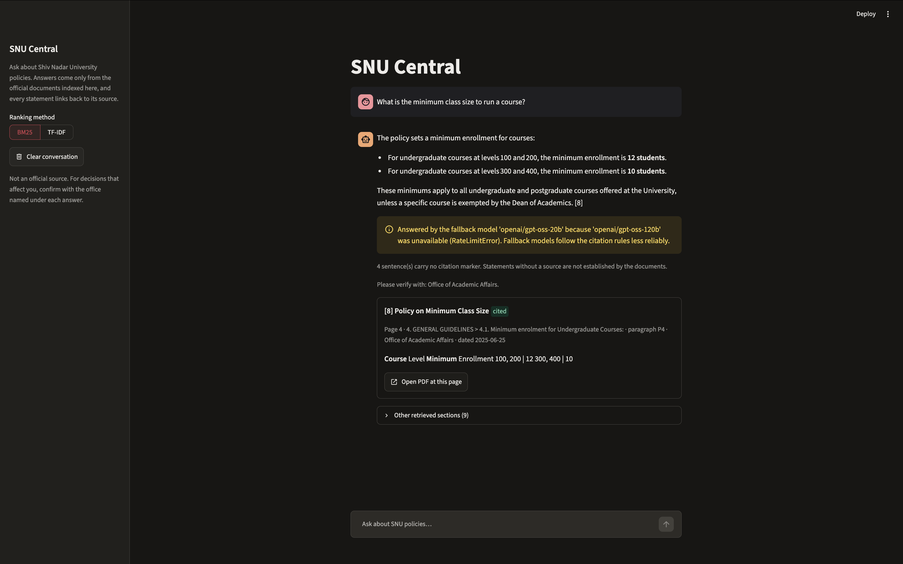
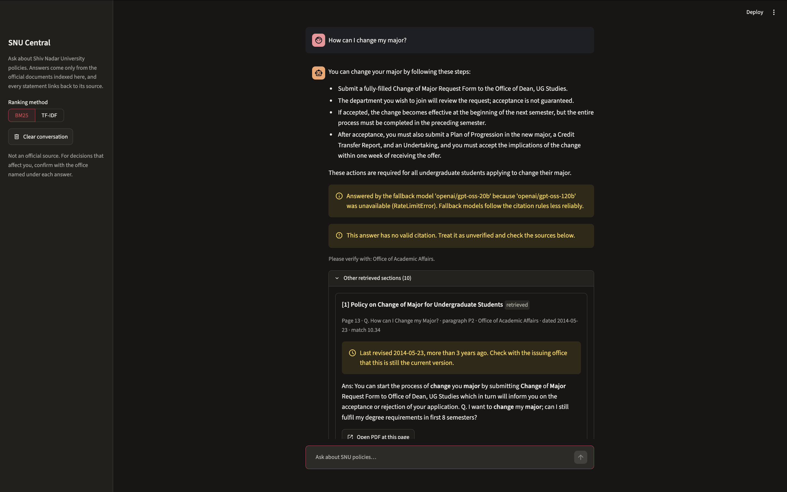
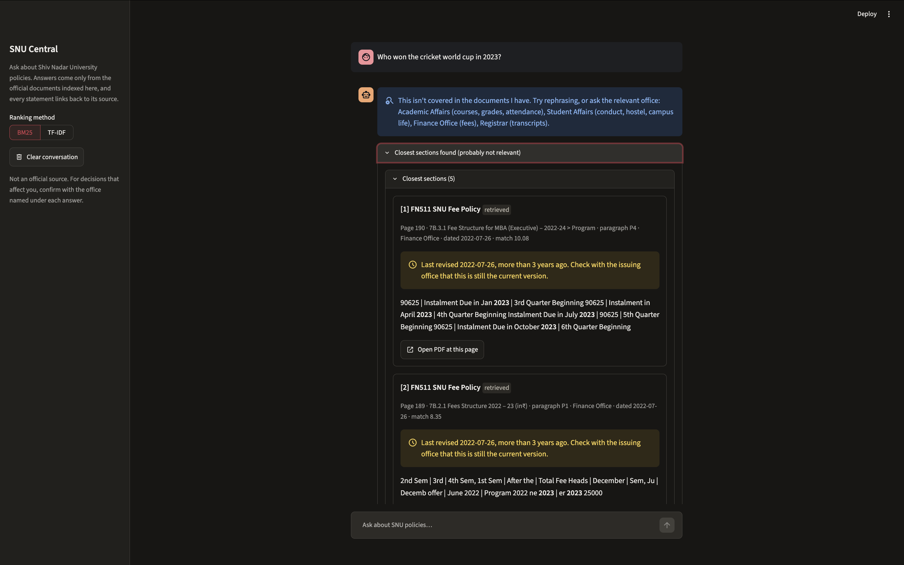
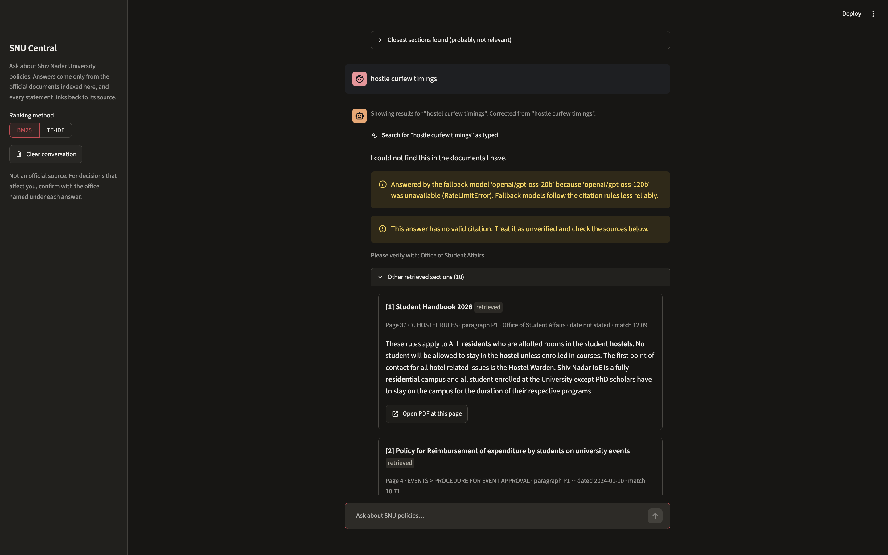
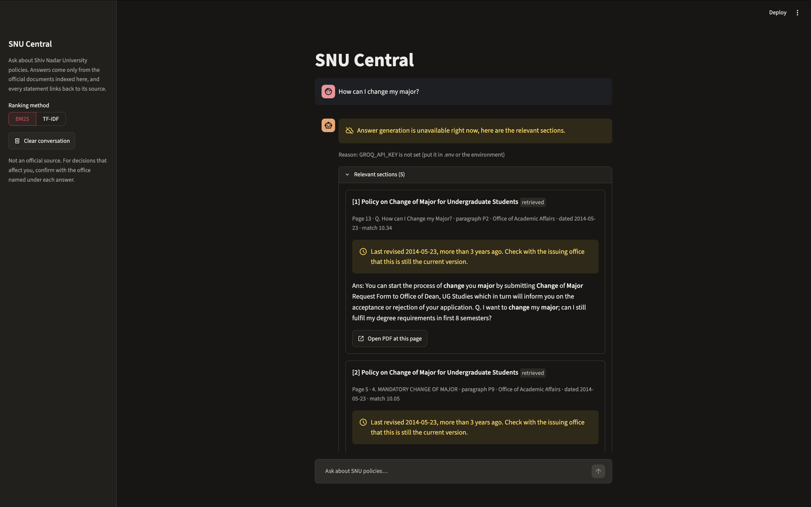
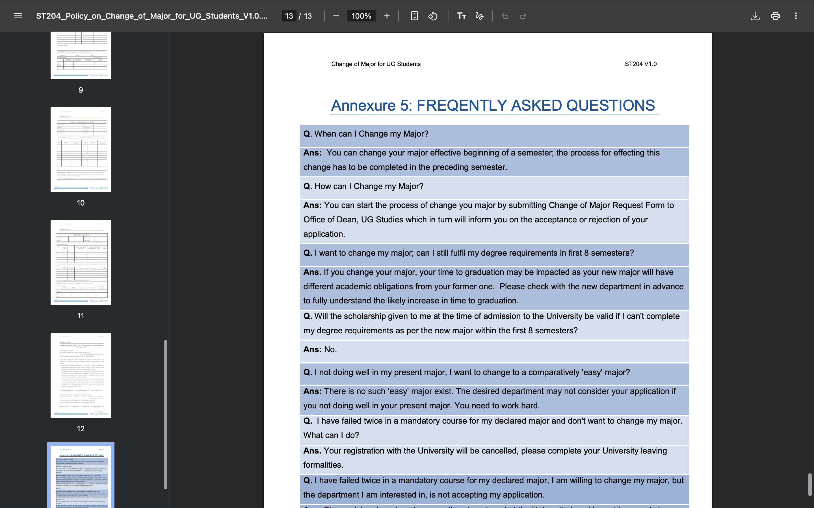

# SNU Central

**Live demo: [snu-central.streamlit.app](https://snu-central.streamlit.app/)** — ask a question about SNU policies and open any cited page of the source PDF.

Ask a question about Shiv Nadar University's policies in plain words and get an answer built only from the official documents, with every statement linked to the document, page, section and paragraph it came from.

The information-retrieval core (inverted index, TF-IDF + cosine, BM25, abstention gate, spelling correction) is our own code. An open-weight LLM (`openai/gpt-oss-120b` on Groq's free tier) only writes the final answer from the passages that retrieval selected.

- Requirements: [`overview.md`](overview.md) (FR-x / NFR-x)
- Design and the decisions behind it: [`system_design.md`](system_design.md) (§12 lists what changed during the build and why)
- Project report (IEEE format): [`IR_REPORT.pdf`](IR_REPORT.pdf)

## About

SNU Central is our end-semester project for **CSD358 Information Retrieval** at Shiv Nadar Institution of Eminence (Monsoon 2026). Students lose time hunting through long policy PDFs spread across several university websites; SNU Central lets them ask in their own words and shows exactly where each answer comes from, or says plainly when the documents don't cover it.

On 25 test questions over 39 policy documents, BM25 reached an MRR of 0.792 (TF-IDF 0.581), the system declined all five off-topic questions without refusing any real one, and 94% of answer statements were supported by a cited passage.

Try it at **https://snu-central.streamlit.app/** (the app may take about a minute to wake up if nobody has used it for a few days).

**Team:** Vishnu Chundu · Poorab Mishra · Shreyas Achal · Mitaksh Goswami

---

## Quick start

Tested on a MacBook Air M1 (8 GB) with Python 3.13.

```bash
cd EndProject
python3 -m venv .venv && source .venv/bin/activate
pip install -r requirements.txt

# Groq API key (free at console.groq.com). Either of these; both are git-ignored:
echo 'GROQ_API_KEY=your_key' > .env
# or: cp .streamlit/secrets.toml.example .streamlit/secrets.toml  and edit it
# optional: echo 'GROQ_API_KEY_2=backup_key' >> .env   (used only if the first key is rejected)

python build_index.py     # extract, clean, chunk, date, de-duplicate, index  (~6 s; the app also does this on first start)
streamlit run app.py      # open http://localhost:8501
# optional: python fetch.py  re-downloads the 39 source PDFs from SNU and updates the manifest
```

Without a key the app still works: it shows the relevant passages with their citations instead of a generated answer.

## Commands

| Command | What it does |
|---|---|
| `python fetch.py` | Downloads sources S1–S4 (`sources.yaml`), skips unchanged files (SHA-256), writes `processed_data/manifest.csv` |
| `python build_index.py` | PDFs → `processed_data/chunks.jsonl` → `indexes/index.pkl`; prints chunks and the date found for every document |
| `streamlit run app.py` | Chat interface |
| `python -m snu_central.retrieval "attendance" [--ranker tfidf] [-k 5]` | Retrieval only, no LLM (NFR-3.2) |
| `python -m snu_central.generation "How do I change my major?"` | Full pipeline in the terminal |
| `python -m snu_central.generation --models` | Models Groq offers right now, and which configured ones are usable |
| `pytest` | 35 unit tests; no network needed |
| `python evaluate.py` | P@5, R@5, MRR for TF-IDF vs BM25, spelling robustness, retrieval latency → `eval/results/` |
| `python evaluate_answers.py` | Runs all 25 eval questions through the full pipeline → `eval/results/answers-*.csv` and `statements-*.csv` for manual grading (~10 min; uses ~55k of the free tier's 200k tokens/day) |
| `python evaluate_answers.py --summarize <csv>` | Summary of a graded answers file |
| `python evaluate_answers.py --statements <answers csv>` | Splits answers into statements, pre-checks each against its cited passages, writes `statements-*.csv` for grading; run it on a `statements-*.csv` to get the NFR-1.1 score |

## How it works

```
question ─► spelling correction ─► analyzer (tokenize, stop words, Porter stem, synonyms)
         ─► BM25 over our inverted index (top 5) ─► abstention gate (no LLM call if it fails)
         ─► + neighbouring chunks as context ─► prompt v4 with numbered <passage> blocks
         ─► Groq, streamed, temperature 0 ─► [n] markers checked against the passages
         ─► answer + source cards (document, page, section, paragraph, date, "Open PDF at this page")
```

- **Documents:** 39 PDFs from four public SNU sources: the UG Handbook, Student Handbook 2026, a student-relevant allow-list from Mandatory Disclosure, and the SNU Links student policies. Chunks are paragraphs with full metadata (FR-2.8); exact repeats are merged.
- **Citations are built by the app**, never written by the LLM: the model only writes `[3]`, and the app turns that into the document, page and section from chunk metadata (FR-6.4). Invalid markers are removed and flagged.
- **Abstention:** if no query word is in the index, or BM25 confidence is below `abstain_threshold`, the LLM is not called. Off-topic questions that get past the gate are declined by the prompt.
- **Dates** come from the documents themselves (release-control table, "effective from …"); documents last revised more than `stale_after_years` ago carry a warning. Five documents state no date and show "date not stated".
- **Swappable:** ranker (`bm25` | `tfidf`), LLM provider (`groq` | `ollama`), model, prompt version, K and every threshold live in `config.yaml` (NFR-4.4). If Groq retires the configured model, the next one in `fallback_models` that Groq still lists is used. If the API key is rejected (revoked or expired), an optional backup key `GROQ_API_KEY_2` is tried; keys of one Groq account share its rate limits, so this does not add quota.

## Results

Evaluation set: 20 answerable student questions with 92 hand-labelled relevant passages, plus 5 unanswerable or off-topic questions (`eval/queries.csv`, `eval/qrels.csv`).

**Retrieval** (`python evaluate.py`)

| Ranker | P@5 | R@5 | MRR |
|---|---|---|---|
| TF-IDF + cosine | 0.430 | 0.492 | 0.581 |
| **BM25** (k1 = 1.5, b = 0.5) | **0.580** | **0.660** | **0.792** |

**Answers** (`python evaluate_answers.py`, prompt v4)

| Criterion (target from `overview.md` §5) | Result |
|---|---|
| Correct abstention on unanswerable questions (≥ 80%) | 5/5 |
| False abstention on answerable questions | 0/20 |
| Answers with valid citations, none invalid (100%) | 20/20 |
| Numbers in answers that appear in no passage | 0/20 answers |
| Factual correctness, manual | 19/20 |
| **Statements supported by a cited passage (NFR-1.1, ≥ 90%)** | **85/90 = 94%** (14 read by hand, 76 auto-passed: cited and ≥ 60% of words in the cited passage; uncited statements count as unsupported) |
| Completeness (conditions and exceptions kept), manual | 13/20 |

**Other measurements**

| | Result |
|---|---|
| Typos restored by spelling correction | 20/20 (MRR 0.629 with typos → 0.792 corrected) |
| Retrieval latency (target < 500 ms) | median 0.2 ms, max 0.8 ms |
| Full answer with `gpt-oss-120b` (target ~5 s; text streams from the first token) | median 0.9 s, max 1.5 s |
| Index on disk / load time | 0.8 MB / 0.2 s |

Answer grades are in `eval/results/answers-20261122-215752.csv` (`correct`, `supported`, `citation_ok`, `complete`, `notes`); statement grades in `eval/results/statements-20261122-215752.csv`. Files marked `FALLBACK-gpt-oss-20b` are runs made after the daily token limit was reached; they show that the smaller fallback model cites less reliably (16–17/20 answers cited) and are not the reported results.

**Limitations**
- One factual error remains (Q08): a refund schedule that applies to one certificate programme is presented as the default, because that programme has no heading in the Fee Policy PDF and the general "UGC norms" rule ranks lower.
- Most incomplete answers are retrieval misses: penalty lists in ST212, the fourth-year attendance rule, the full disability policy, and grade-conversion tables that share no words with the question. The answers say what the documents provided do not cover rather than guess.
- P@5 is just below the 0.6 target. `bm25_b` and prompts v2–v4 were tuned on the same 20 questions, so the scores are somewhat optimistic.
- Relevance labels and grades were made by one person (with the AI assistance declared below), not by independent annotators.
- Groq's free tier allows 200,000 tokens per day for `gpt-oss-120b`; one evaluation run uses about 55k. Past the limit, answers come from `gpt-oss-20b` and the app says so on each answer.

## Screenshots

| | |
|---|---|
|  Landing page with example questions |  Answer with source cards |
|  Source card with "last revised" warning |  Off-topic question: no LLM call |
|  Spelling correction ("corrected from") |  No API key: passages-only fallback |
|  "Open PDF at this page" lands on the cited page | |

## Configuration (`config.yaml`)

| Key | Default | Meaning |
|---|---|---|
| `retrieval.ranker` | `bm25` | or `tfidf` (also switchable in the app sidebar) |
| `retrieval.top_k` | 5 | passages retrieved |
| `retrieval.context_top` / `context_cap` | 5 / 10 | neighbours of the best N hits added for the LLM, maximum passages sent |
| `retrieval.bm25_k1` / `bm25_b` | 1.5 / 0.5 | BM25 parameters |
| `retrieval.abstain_threshold` | 0.20 | BM25 confidence below which the LLM is not called; re-tune with `evaluate.py` after re-indexing |
| `llm.model` / `fallback_models` | `openai/gpt-oss-120b` / `gpt-oss-20b`, … | checked against Groq's live model list |
| `llm.prompt_version` | `v4` | versioned prompts in `snu_central/generation/prompt.py` |
| `app.stale_after_years` | 3 | age after which a citation shows a "last revised" warning |

Hand-checked dates for documents the extractor cannot date go in `document_dates.yaml`.

## Data and usage

All documents are publicly downloadable from snu.edu.in and snulinks.snu.edu.in; pages that need an SNU login are skipped, and the Dean's List archive (student names and roll numbers) is excluded. The SNU Links policies carry a notice that they are for the exclusive use of SNU and may not be stored in a retrieval system without prior written permission. All documents remain the property of Shiv Nadar University; this project and its demo are a student course project intended for SNU students, and any document will be removed on the university's request. The source PDFs and their manifest are included in the repository so the app can build its index; generated data and logs are git-ignored. Query logs redact emails, phone and roll numbers.

## AI assistance (NFR-8.1)

- **Claude Code (Anthropic)** was used throughout development: writing and debugging the code in `snu_central/`, the entry-point scripts and the tests; designing and running the evaluation scripts; proposing the relevance judgments in `eval/qrels.csv` and first-pass answer and statement grades; and editing `system_design.md`, `overview.md` and this README. The author directed the work, made the design decisions, and checked the grades in `answers-20261122-215752.csv` and `statements-20261122-215752.csv` (notes say "Graded by Claude, checked by author").
- **Groq `openai/gpt-oss-120b`** generates the answers at run time from the retrieved passages. It is an existing open-weight model; no model was trained or fine-tuned (NFR-7.3).
