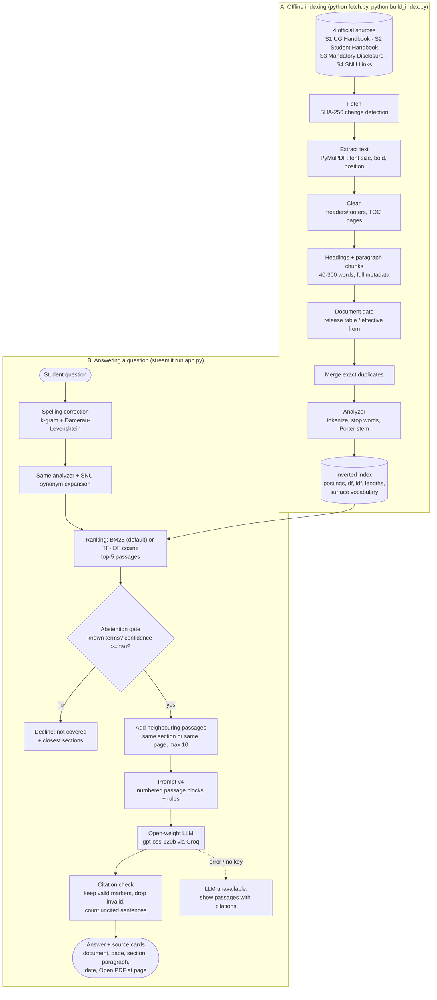

# IV. Proposed Model

SNU Central is a retrieval-augmented question-answering system with two parts (Fig. 1): an **offline indexing pipeline** that turns official PDF documents into an inverted index of citable passages, and an **online answering pipeline** that retrieves passages for a student's question, decides whether they are good enough to answer from, and only then asks an LLM to write an answer whose citations the application checks. The IR engine works on its own; the LLM is a replaceable last step.

## A. System Diagram

**Fig. 1. SNU Central pipeline.** A: offline indexing. B: answering a question. The dashed arrow is the fallback taken when the LLM is unavailable.

<!-- Rendered figure for LaTeX: fig1_pipeline.svg (convert to PDF for \includegraphics). Mermaid source below. -->

## B. Offline Indexing Pipeline

1. **Document collection.** Documents come from four official, publicly accessible sources: the UG Handbook (S1), the Student Handbook 2026 (S2), a student-relevant allow-list from the Mandatory Disclosure page (S3), and the student-policy tree of the SNU Links portal (S4), where each policy page embeds its PDF. Every file is stored with its source URL, fetch time and SHA-256 hash; unchanged files are skipped on later runs and identical files from two sources are stored once. Pages that need an SNU login, and an archive listing students' names, are excluded.
2. **Text extraction and cleaning.** PyMuPDF extracts each line with its font size, weight and position. Lines that repeat in the page margins on more than half of the pages (running headers and footers), table-of-contents pages and boilerplate are removed.
3. **Structure and chunking.** Headings are detected from numbering (`4.2`, `A1.`, `SECTION A:`) and from larger or bold type; numbered lines that read as sentences are treated as list items, not headings. A stack of open headings gives each paragraph a section path such as *4. GENERAL GUIDELINES > 4.1. Minimum enrolment*. Paragraphs are merged up to at least 40 words and split above 300, never across a section boundary.
4. **Metadata.** Each passage keeps its document name, file, category, department, page, section, paragraph number and source URL. The **document date** is read from the document itself — the latest entry of the "Release Control" table most SNU policies carry, or an explicit "effective from" line — and left empty when the document states none.
5. **De-duplication and indexing.** Passages with identical text (the fee policy repeats whole passages for each programme) are merged, keeping a record of the duplicates. The same analyzer later used for queries tokenises, removes stop words and stems each passage, and the inverted index stores, for every term, the passages it occurs in with their term frequency, together with document frequencies, passage lengths and the vocabulary of surface words used for spelling correction. The index is saved to disk with a hash of the analyzer settings so that a mismatched index is refused.

## C. Online Answering Pipeline

1. **Spelling correction.** Query words that occur nowhere in the collection are replaced by their closest vocabulary word, and the interface shows *"Showing results for … (corrected from …)"* with a button to search the original wording instead.
2. **Query analysis.** The query goes through exactly the same analyzer as the documents and is expanded with a hand-built SNU synonym dictionary (for example *drop ↔ withdraw*, *CGPA ↔ cumulative grade point average*).
3. **Ranking.** BM25 (default) or TF-IDF with cosine similarity scores the passages that contain at least one query term, and the top five are kept.
4. **Abstention gate.** If no query term exists in the index, or the BM25 confidence — the top score divided by the highest score the query could reach — is below a threshold, the system replies that the question is not covered, shows the closest sections, and does **not** call the LLM.
5. **Context.** The neighbouring passages of the top hits are added (same section first, other sections only on the same page), up to ten passages, because answers often sit in a table or list item next to the paragraph that matched.
6. **Generation.** The passages are numbered `[1]`–`[10]` and placed in delimited blocks with their document, section and date. The prompt (version 4) instructs the model to answer only from these passages, cite a passage number after every claim, add no details the passages do not state, say which programme or group a rule applies to, keep every exception, answer the covered part of a question and name what is not covered, decline questions unrelated to the university, and never decide whether a particular student is eligible. The answer streams from `gpt-oss-120b` on Groq at temperature 0.
7. **Citation check and display.** After streaming, the application normalises marker variants, keeps markers that point to a sent passage, removes and flags the rest, and counts sentences without a marker. The answer is shown with numbered *source cards* — document, page, section, paragraph text with query words highlighted, date with a warning for old revisions, and a link that opens the PDF at the cited page.
8. **Graceful degradation.** If the LLM fails (no key, network error, rate limit or timeout), the retrieved passages are still shown with their citations. If the preferred model is unavailable, a fallback model answers and the answer says so; a backup API key is used if the first is rejected.

## D. Worked Example

For the question *"What is the minimum class size to run a course?"*:

- **Analysis:** stop words are removed and the remaining words stemmed to `minimum, class, size, run, cours`.
- **Ranking (0.4 ms):** the top hit is the definition of minimum enrollment in the *Policy on Minimum Class Size* (p. 4, BM25 score 17.91). The BM25 confidence is 0.38, above the threshold of 0.20, so the gate passes.
- **Context:** the actual numbers are in a table under the *next* heading on the same page, which shares no word with the question and is not in the top five. Neighbour expansion adds it as passage `[8]`.
- **Answer:** *"100- and 200-level undergraduate courses: at least 12 students `[8]`; 300- and 400-level courses: at least 10 students `[8]`."* The application turns `[8]` into a source card for *Policy on Minimum Class Size, p. 4, section 4.1, dated 2025-06-25*, with a link to that page of the PDF.

## E. Implementation

**Table III. Components and technologies**

| Component | Implementation |
|---|---|
| Language and interface | Python 3.13; Streamlit chat application with streaming, run locally |
| PDF processing | PyMuPDF; our own cleaning, heading detection and chunking |
| Text processing | Our own tokenizer and stop-word list; NLTK Porter stemmer |
| Index and ranking | Our own inverted index, TF-IDF + cosine and BM25 (no search library) |
| Spelling correction | Our own character bigram index and Damerau–Levenshtein distance |
| LLM | `openai/gpt-oss-120b` (open-weight) through Groq's OpenAI-compatible API; `gpt-oss-20b` as fallback; a local Ollama provider is implemented behind the same interface but was not evaluated |
| Configuration | One file (`config.yaml`): ranker, *K*, BM25 parameters, threshold, model, prompt version |
| Hardware and cost | MacBook Air M1, 8 GB RAM; Groq free tier; running cost $0 |

The design follows three rules taken from the project brief: **retrieval before generation** (the LLM never sees a question without passages), **source transparency** (citations are built from metadata, never written by the model), and **accuracy over assumptions** (decline rather than guess).
