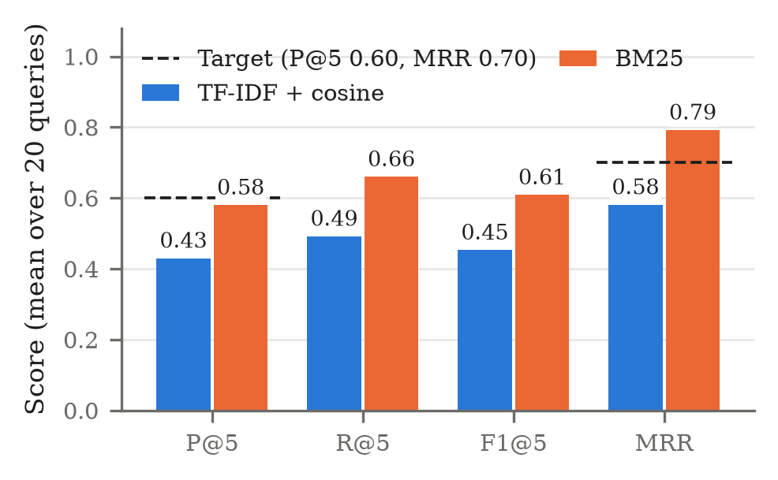
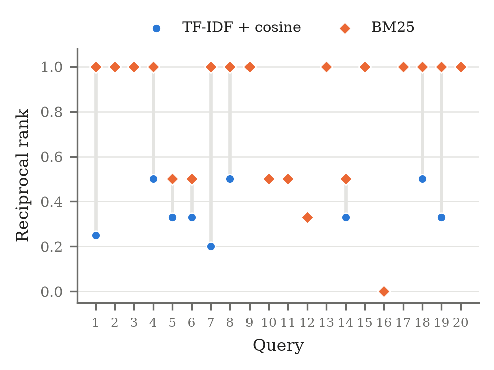
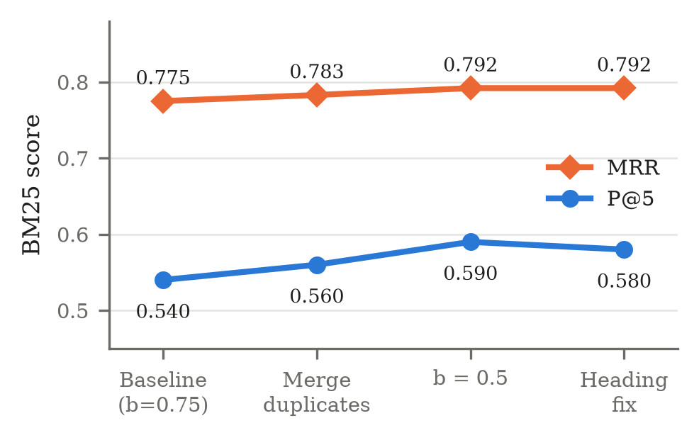
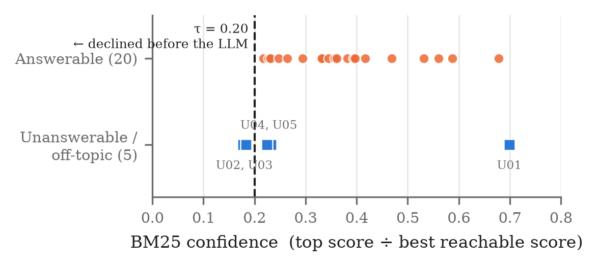

# VI. Experimentation and Results

<!-- Figures: fig2_retrieval, fig3_per_query_rr, fig4_gate_confidence, fig5_ablation (.pdf for LaTeX, .png for preview),
     regenerated from the evaluation files by:  .venv/bin/python "report_md's/make_figures.py"
     Source files: eval/results/retrieval-*.txt (latest), eval/results/answers-20261122-*.csv,
     eval/results/statements-20261122-215752.csv, system_design.md §12. -->

## A. Experimental Setup

All experiments ran on the reference machine, a MacBook Air M1 with 8 GB of RAM, using Python 3.13. Retrieval used our own implementation with $K = 5$, BM25 parameters $k_1 = 1.5$, $b = 0.5$, and abstention threshold $\tau = 0.20$. Answers were generated by `openai/gpt-oss-120b` through Groq's free tier at temperature 0 with low reasoning effort, using prompt version 4 unless stated otherwise. Every answer reported in the main tables was produced by `gpt-oss-120b`; runs in which a rate limit caused the smaller fallback model to answer are reported separately (Section VI-F). Retrieval is deterministic, which we verified by rebuilding the exact passages sent to the model for each saved answer.

## B. Datasets

### 1) Document collection

**Table IV. Document collection**

| Property | Value |
|---|---|
| Sources | 4 official, publicly accessible SNU sources (S1 UG Handbook, S2 Student Handbook 2026, S3 Mandatory Disclosure allow-list, S4 SNU Links student policies) |
| Documents | 39 PDFs (S1: 1, S2: 1, S3: 5, S4: 32) |
| Categories | Academic affairs 15, student affairs 12, university administration 5, finance 4, examinations 2, international office 1 |
| Pages | 660 (largest: fee policy, 198 pages) |
| Passages | 3,018 extracted; 2,801 after merging 217 exact duplicates |
| Words | 142,098 in the indexed passages (mean 50.7, median 47 words per passage) |
| Index | 6,191 terms, 72,610 postings, mean passage length 33.2 index terms, 0.8 MB on disk |
| Documents with a date stated in the document | 34 of 39 |

### 2) Evaluation set

No public test collection exists for this domain, so we built one (Table V). Twenty **answerable** questions cover 20 different policy topics — attendance, grading, credit limits, change of major, Dean's List, academic integrity, generative-AI use, fee refunds, transcripts, code of conduct, grievances, ragging, disability support, on-campus jobs, MOOC credits, exchange grade conversion, minimum class size, lateral entry, banned substances and CCTV access. Five **unanswerable or off-topic** questions test abstention: a pizza recipe, the 2023 cricket world cup, an essay request, tomorrow's cafeteria menu and a company's placement package — the last two sound university-related but are not covered by the policies.

Relevance was judged at passage level. For each answerable question, the top eight passages of both rankers were pooled and read, and every passage that directly states (part of) the answer was marked relevant. This gave **92 relevant passages (3–7 per question, mean 4.6) from 22 different documents**. When the collection was later re-chunked (Section VI-C), each judgment was re-mapped to the passage containing the same text and checked by hand.

**Table V. Evaluation set**

| | Count |
|---|---|
| Answerable questions | 20 |
| Unanswerable / off-topic questions | 5 |
| Relevance judgments (relevant passages) | 92 |
| Relevant passages per question | 3–7 (mean 4.6) |
| Documents containing relevant passages | 22 |

## C. RQ1 — Retrieval: BM25 versus TF-IDF

**Table VI. Retrieval results (mean over 20 answerable questions, $K = 5$)**

| Ranker | P@5 | R@5 | F1@5 | MRR |
|---|---|---|---|---|
| TF-IDF + cosine | 0.430 | 0.492 | 0.453 | 0.581 |
| **BM25** ($k_1=1.5$, $b=0.5$) | **0.580** | **0.660** | **0.609** | **0.792** |
| Relative gain of BM25 | +35% | +34% | +34% | +36% |

**Fig. 2.** Retrieval quality of TF-IDF with cosine similarity and BM25. Dashed lines mark the targets fixed before evaluation.

BM25 is better on every measure (Table VI, Fig. 2). Per question (Fig. 3), BM25 ranks a relevant passage first for 13 of the 20 questions against 7 for TF-IDF; its reciprocal rank is higher on 9 questions and never lower, and its P@5 is higher on 10, equal on 9 and lower on 1. The difference comes from the two terms BM25 adds to TF-IDF: **saturation** stops a passage that repeats a query word many times (such as fee tables) from dominating, and **length normalisation** stops very short passages (headings, title pages) from winning on cosine similarity alone, which was the main failure of TF-IDF on questions 1 and 7, where its top results were 2- to 15-word title fragments such as *"and Attendance"*. BM25 meets the MRR target (0.792 ≥ 0.70) but falls just short of the P@5 target (0.580 against 0.60).

**Fig. 3.** Reciprocal rank of the first relevant passage for each question. Grey bars join the two rankers' results for the same question.

Only question 16 (*"How are grades converted for an outgoing exchange semester abroad?"*) fails for both rankers: the answer is in grade-conversion tables whose extracted text (*"A+ A A A A- A B+ B …"*) shares no word with the question.

**Ablation.** Every retrieval change was kept or rejected on the basis of this evaluation (Fig. 5, Table VII).

**Fig. 5.** BM25 P@5 and MRR after each accepted change.

**Table VII. Retrieval changes tried (BM25)**

| Change | P@5 | R@5 | MRR | Decision |
|---|---|---|---|---|
| Baseline ($b = 0.75$) | 0.540 | 0.626 | 0.775 | — |
| Merge 226 exact-duplicate passages | 0.560 | 0.644 | 0.783 | kept |
| $b = 0.75 \to 0.5$ | 0.590 | 0.677 | 0.792 | kept |
| Numbered sentences are not headings (re-chunking) | 0.580 | 0.660 | 0.792 | kept: gives correct section citations |
| Append title and section to passage text (×1) | 0.540 | 0.622 | 0.797 | rejected |
| Append title and section (×3) | 0.440 | 0.508 | 0.695 | rejected |
| Seven broader synonym groups | 0.560 | 0.644 | 0.783 | rejected |
| Drop passages under 8–12 words | no gain at $b = 0.5$ | | | rejected |

The heading fix lowered P@5 slightly (0.590 → 0.580) because passages were re-cut, but it corrected wrong section names in the citations of the 198-page fee policy, and citation correctness is a hard requirement. Table VIII shows the parameter sweep behind the choice of $b$: lowering $b$ helps because our passage lengths vary widely, while $k_1$ matters little.

**Table VIII. BM25 parameter sweep (after duplicate merging)**

| $k_1$ | $b$ | P@5 | R@5 | MRR |
|---|---|---|---|---|
| 1.2 | 0.75 | 0.570 | 0.652 | 0.783 |
| 1.5 | 0.75 | 0.560 | 0.644 | 0.783 |
| 2.0 | 0.75 | 0.560 | 0.647 | 0.767 |
| 1.5 | 0.90 | 0.570 | 0.655 | 0.704 |
| 0.9 | 0.40 | 0.560 | 0.649 | 0.817 |
| 1.2 | 0.50 | 0.590 | 0.677 | 0.792 |
| **1.5** | **0.50** | **0.590** | **0.677** | **0.792** |

## D. RQ2 — Abstention

**Fig. 4.** BM25 confidence (eq. 6) of the 20 answerable and 5 unanswerable questions. Questions left of $\tau$ are declined without calling the LLM.

Fig. 4 shows that the confidence score separates most, but not all, unanswerable questions: U02 (cricket) and U03 (essay) fall below $\tau = 0.20$, while U04 (cafeteria menu) and U05 (placement package) score 0.23 and 0.22 — the same range as the weakest answerable questions — and U01 (pizza recipe) scores 0.70: *recipe*, *margherita* and *pizza* are not in the index, so the only matched word is *good*, which matches "good academic standing" — a single matched term makes the normalised score high. No threshold separates all 25 questions; the best possible accuracy of the gate alone is 88% (eq. 7). We therefore keep $\tau$ low and rely on the prompt as a second layer.

**Table IX. Abstention as classification (positive = declined)**

| | TP | FN | FP | TN | Accuracy | Precision | Recall | F1 |
|---|---|---|---|---|---|---|---|---|
| Gate only (before the LLM), BM25 | 2 | 3 | 0 | 20 | 0.88 | 1.00 | 0.40 | 0.57 |
| Gate only, TF-IDF | 1 | 4 | 0 | 20 | 0.84 | 1.00 | 0.20 | 0.33 |
| **Gate + prompt (end to end)** | **5** | **0** | **0** | **20** | **1.00** | **1.00** | **1.00** | **1.00** |

The gate never refuses an answerable question (precision 1.00), and it stops two of the five off-topic questions before any LLM call. The LLM declines the remaining three, giving perfect abstention end to end with **no false refusals** (Table IX). This result was stable across all six evaluation runs made with `gpt-oss-120b`.

## E. RQ3 — Answer Quality and Groundedness

### 1) Effect of the design changes

Table X traces answer quality through the evaluation-driven changes. Each row is a complete run over the 25 questions.

**Table X. Answer quality across system versions (`gpt-oss-120b`)**

| Version | Wrong refusals (of 20) | Answers with valid citations | Correct | Complete |
|---|---|---|---|---|
| Prompt v1, top-5 passages only | 4 | 16/16 | — | — |
| v1 + neighbouring passages | 1 | 19/19 | 17/19 | 12/19 |
| v2: say which programme a rule applies to; keep all exceptions | 1 | 19/19 | 18/19 | 13/19 |
| v3: answer the covered part; heading fix; same-section neighbours | 0 | 20/20 | — | — |
| v3 + neighbours of all top-5 hits (≤ 10 passages) | 0 | 20/20 | — | — |
| **v4: add no details the passages do not state** | **0** | **20/20** | **19/20** | **13/20** |

"—" marks runs that were not graded in full. All runs declined 5/5 unanswerable questions and produced no invalid citation marker.

Two changes had the largest effect. **Neighbouring passages** cut wrong refusals from 4 to 1: in four cases the model had correctly refused because the answer — for instance the table of minimum class sizes — was in a passage next to the one retrieved. **Prompt v3** removed the last wrong refusal by letting the model answer the covered part of a two-part question (*"What is the anti-ragging policy and punishment for ragging?"*) and state that the documents do not specify the punishment. **Prompt v4** was added after we found that the v3 answer to the disability-support question listed examples (*"screen readers, ramps"*) that do not appear in the source; v4 forbids details the passages do not state, and the rerun removed them.

### 2) Final answer quality

**Table XI. Final system (prompt v4), 20 answerable questions**

| Measure | Result |
|---|---|
| Factual correctness (accuracy) | 19/20 = 95% |
| Evidence support (answer level) | 20/20 = 100% |
| Citation accuracy (correct document, page, paragraph) | 20/20 = 100% |
| Completeness (all conditions and exceptions kept) | 13/20 = 65% |
| Answers with a number that appears in no passage | 0/20 |
| Answers with an invalid citation marker | 0/20 |

### 3) Statement-level groundedness

The 20 answers contain **90 statements** (Table XII). 68 carry their own citation marker, 14 are list items covered by the citation that closes their list, 3 state that the documents do not contain something, and 5 have no citation. Statements were first scored automatically by word support (eq. 15); the 14 that scored below 0.6 or had no citation were read against their passages, and the other 76 passed the automatic check.

**Table XII. Statement-level groundedness**

| Measure | Result |
|---|---|
| Statements | 90 |
| Statements covered by a citation | 83/90 = 92% |
| **Citation precision**: cited statements supported by the cited passage | **83/83 = 100%** |
| **Groundedness**: statements supported by a cited passage (eq. 14) | **85/90 = 94%** (target ≥ 90%) |
| Unsupported statements | 5: four true but uncited summary sentences, one wrong generalisation (Q08) |

Every statement that carries a citation is supported by the passage it cites. All five failures are uncited sentences, usually a closing summary such as *"So, you can use ChatGPT for early-stage idea generation…"*. Under the strict rule of the requirements, an uncited statement is not established by the documents, so these count as failures even when they are true.

## F. Effect of the Language Model

Groq's free tier limits `gpt-oss-120b` to 200,000 tokens per day, and one evaluation run uses about 55,000. After the eighth run of the day the limit was reached and the system automatically fell back to `gpt-oss-20b`, which answered most of the following two runs. With the same retrieval and prompt, the smaller model gave **valid citations in only 16/20 and 17/20 answers**, against 20/20 for `gpt-oss-120b`; it tended to drop markers or group them at the end of the answer. Abstention stayed at 5/5. This is why the interface now states on every answer when a fallback model was used.

## G. RQ4 — Spelling Correction

For each answerable question, two adjacent letters in the middle of its longest word were swapped (for example *attendance → attednance*, *semester → semseter*). The speller restored **20 of 20** words. With the typos, BM25 MRR fell from 0.792 to **0.629**; after correction it returned to **0.792**, recovering the full loss. The correction never changed any of the 25 correctly spelled evaluation questions, and it made no suggestion for the five off-topic questions, whose unknown words (*pizza*, *margherita*, *cricket*) have no near neighbour in the vocabulary. A misspelling that shares its stem with a real word (*attendence → attend*) is not corrected, but it already matches the right passages.

## H. Efficiency

**Table XIII. Efficiency on the reference machine**

| Measure | Result | Target |
|---|---|---|
| Retrieval time per question | median 0.2 ms, max 0.8 ms | < 500 ms |
| Spelling correction per query | 1–2 ms | — |
| Full answer (`gpt-oss-120b`, streamed) | median 0.9 s, max 1.5 s | ≈ 5 s |
| Index load at start-up | 0.2 s | — |
| Full rebuild (extract, chunk, date, index) | 5.8 s | — |
| Index size on disk | 0.8 MB | — |

## I. Comparison with Existing Research

**Table XIV. Comparison with published results**

| Study | Setting | Reported result | SNU Central |
|---|---|---|---|
| Liu, Zhang & Liang 2023 [@liu2023verifiability] | 4 commercial generative search engines, open-web questions, human audit | 51.5% of sentences fully supported by their citations; 74.5% of citations support their sentence | **94%** of statements supported; **100%** of citations support their statement |
| Gao et al. 2023 (ALCE) [@gao2023alce] | LLMs answering with citations, long-form questions | Even the best models lack complete citation support for about half of their answers on ELI5 | 92% of statements covered by a citation; all answers have at least one valid citation |
| Thakur et al. 2021 (BEIR) [@thakur2021beir] | 18 retrieval datasets, zero-shot | BM25 a robust baseline across new domains; dense models often generalise poorly | BM25 beats TF-IDF by 36% MRR on an unseen domain without any training |
| Neupane et al. 2024 (BarkPlug v.2) [@neupane2024barkplug] | RAG chatbot for one university's campus resources | Mean RAGAS score 0.96, user survey | Comparable goal; we report IR metrics and manually checked groundedness instead of an LLM-judged score |

The comparison with Liu et al. is the most direct, because both measure whether each generated sentence is supported by the source it cites. SNU Central's much higher support rate comes from its design rather than a stronger model: the model may only cite passages that retrieval supplied, the application rejects any other citation, and the prompt forbids details the passages do not contain. The settings differ, however, and the numbers are not directly comparable: Liu et al. evaluated commercial systems on open-web questions with independent annotators, whereas we evaluate 20 questions over a closed collection, graded by one author with AI assistance, and 76 of the 90 statements passed an automatic word-support check rather than a full reading. Our result shows that this design *can* reach high groundedness in a narrow domain; a larger, independently annotated test would be needed to confirm it.

## J. Discussion and Error Analysis

**Retrieval is the bottleneck.** Of the seven incomplete answers, five are retrieval misses rather than model errors: the ST212 penalty lists for the code-of-conduct question, the fourth-year 50% attendance rule, the full disability-support policy (the handbook's one-paragraph summary ranks higher), the grade-conversion tables, and the sentence stating that ragging is a punishable offence. In each case the model correctly said what the provided documents did not cover instead of guessing.

**The one factual error (Q08)** is a policy-structure problem. The fee policy gives a refund schedule (75% / 50% / none) that applies to one certificate programme, but that programme has no heading in the PDF, so its passages appear under an unrelated section. The model, told to say which programme a rule applies to, labelled it as a postgraduate certificate rule — but still presented it as the default, while the general rule ("refunds follow UGC norms and the admission notification") ranked fifth.

**Threats to validity.** The test set is small (25 questions) and was labelled by one person with AI assistance; relevance pools came from our own two rankers, which can make recall look higher than it is; and $b$ and prompts v2–v4 were tuned on the same questions they are evaluated on, so the final numbers are somewhat optimistic. Statement grading combined manual reading (14 statements) with an automatic pre-check (76 statements).
