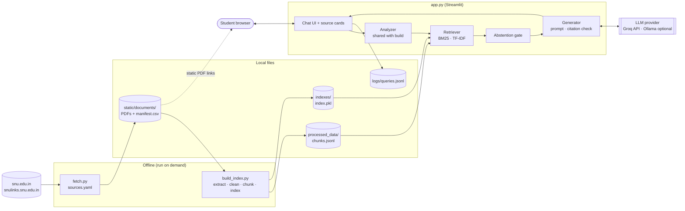

# SNU Central: System Design

> Companion to `overview.md`, which holds the problem statement and the requirements (FR-x / NFR-x IDs referenced below).
> **Status:** design for a **one-day build** by a single developer, running Streamlit locally on a MacBook Air M1 (8 GB RAM).

---

## 1. Context and Constraints

| Constraint | Value | What it forces |
|---|---|---|
| Team | 1 developer | Strictly sequential build; each stage must be usable before the next (§9) |
| Time | One day | Must-haves only. Most *Should* items are deferred (§9). |
| Hardware | MacBook Air M1, **8 GB RAM** | A local 7–8B LLM would compete for RAM with the browser and Streamlit, so we use a hosted LLM (§5) |
| Runtime | Local `streamlit run`, no deployment yet | Single process, local files, no server infrastructure |
| Cost | $0 | Free-tier LLM API, no paid services |
| Course rule | IR core must be our own visible code (NFR-2.3) | No FTS5 `bm25()`, no LangChain retrievers, no vector database |

---

## 2. Data Sources (checked on 22 Nov 2026)

| # | Source | What it actually is | How we fetch it | Size |
|---|---|---|---|---|
| S1 | [UG Handbook](https://snu.edu.in/site/assets/files/11150/ug_handbook.pdf) (academics) | Text PDF, no outline, headings like `SECTION A: GRADING SCALE`, `A1. Grading Scale` | Direct PDF download | 21 pages, ~6.6k words |
| S2 | [Student Handbook 2026](https://snu.edu.in/site/assets/files/24802/student_handbook_2026_final_1.pdf) (regulations) | Text PDF, no outline, numbered headings (`1.2 …`) | Direct PDF download | 78 pages, ~23k words |
| S3 | [Mandatory Disclosure](https://snu.edu.in/home/mandatory-disclosure/) | HTML index of ~55 links: committee notices, annual reports, UGC letters, plus a few student-relevant PDFs | Follow **only the PDF links on an allow-list** in `sources.yaml` | Varies |
| S4 | [Student Policies (SNU Links)](https://snulinks.snu.edu.in/policies/student-policies) | A **folder tree** of `?node=…` pages. Folders list child nodes; **document pages embed their PDF as base64** (`window.SNU_PDF_BASE64`) with the real filename in `window.SNU_PDF_FILENAME`. Most are readable without a login. | Walk the tree breadth-first, extract each embedded PDF | 32 PDFs, ~130k words; FN511 Fee Policy alone is 198 pages |

**S4 findings from the first fetch (22 Nov 2026):**
- *Student Academic Policies* is a sub-folder with attendance, grading, Dean's List criteria, the Examination Manual, academic integrity and more. These are the most valuable documents for student questions.
- **5 pages need an SNU login** (Undergraduate Handbook ×2, Minor Programme ×2, Summer Term Note). They are reported as skipped and not indexed (NFR-2.4). S1 covers the UG Handbook publicly.
- **2 nodes are a Word form and an Excel timesheet** (ST203 annexures). They are skipped as non-PDF.
- **The *Dean's List - Archive* folder is excluded.** It contains lists of student names and roll numbers: personal data, not policy (NFR-9). *Dean's List Criteria* is kept.

**S3 allow-list for v1** (student-relevant only): Disability Support Policy, Anti-Ragging Prevention Information, Holiday List 2026, Student Grievance Redressal Committee, Examinations Committee. Annual reports, UGC approval letters and committee reconstitution notices are excluded. They are noise for student questions.

> ⚠️ **Usage note.** The SNU Links policy PDFs carry the notice *"meant for exclusive use of SNU … No part … may be stored in any retrieval system … without prior written permission."* Indexing them locally for a course project used by SNU students is within the spirit of "exclusive use of SNU". **Do not publicly deploy** an app that serves these documents without permission from the university (NFR-2.4).

---

## 3. Estimates

- **Corpus (measured after the first fetch):** **39 documents, 660 pages, ~164k words** (S1 6.6k, S2 23k, S3 4k, S4 130k). No scanned pages. At ~100 words per chunk that is **≈ 1,700 chunks**.
- **Index in RAM:** ~1,700 chunks × ~60 unique terms ≈ 100k postings. As Python dicts that is **≈ 10–20 MB**, under 0.5% of the 8 GB RAM. On disk as a pickle, a few MB.
- **LLM call:** 5 passages × ~150 tokens + ~500 tokens of instructions + ~250-token answer ≈ **1.5–2k tokens per question**. On Groq's free tier (8k tokens/min, 200k tokens/day for `gpt-oss-120b`) that is **~4 questions/min and ~100 questions/day**. Enough for development, evaluation (~25 queries) and a demo.
- **Measured after the build:** 3,018 chunks (~50 words each), **2,801 after merging exact duplicates**; 6,191 index terms; `index.pkl` **0.8 MB**; index + chunks load in **0.2 s**. Chunks came out smaller than estimated, so up to 10 passages (~50 words each) go to the LLM, still ≈ 1.5–2k tokens per question.

---

## 4. Architecture

A **modular monolith**: one Python codebase with three entry points.

| Entry point | Job | When it runs |
|---|---|---|
| `fetch.py` | Download sources S1–S4 into `static/documents/` and write `processed_data/manifest.csv` | When we want fresh documents |
| `build_index.py` | Extract, clean, chunk, build the index, save to `indexes/` | After every fetch |
| `streamlit run app.py` | Answer questions | Every time |



### Components

| Component | Responsibility | Requirements |
|---|---|---|
| `sources.yaml` | Seed URLs, S3 allow-list, category per source | FR-1.1, FR-1.2 |
| `fetch.py` | Download PDFs; extract base64 PDFs from S4 pages; record URL, SHA-256 hash and fetch time; skip unchanged files | FR-1.3–1.5, NFR-2.2 |
| `manifest.csv` | One row per document: `doc_id, title, category, department, source_url, file_path, sha256, fetched_at, effective_date, is_superseded`. `category` is the subject category (§1.2 of the spec), set per document by `category_rules` in `sources.yaml`. Department and superseded flag can be edited by hand and survive re-fetching. | FR-1.3, FR-2.8 |
| `ingest/` | PyMuPDF text blocks with font sizes → strip repeated page headers and footers (lines on >50% of pages) → detect headings by regex (`SECTION A:`, `A1.`, `1.2`) and larger or bold font; numbered lines that read as sentences ("2. Tuition Fee Waiver not applicable…") are list items, not headings → paragraph chunks; merge chunks under 40 words, split at 300. `dates.py` reads each document's own date (§12) | FR-2.x, FR-6.6 |
| `textproc/analyzer.py` | Lowercase, tokenize, stop words, Porter stemmer, keep numbers. **One function shared by indexing and querying.** `expansion.py` adds the SNU synonym dictionary; `spelling.py` corrects words that occur nowhere in the documents (§12) | FR-2.5, FR-4.2, FR-4.6, FR-4.11 |
| `index/` | Inverted index `term → {chunk_id: tf}`, `df`, `idf`, chunk lengths, average length, surface-word vocabulary; exact-duplicate chunks merged first (`duplicate_ids` kept); saved with `analyzer_hash` + format version | FR-3.x, NFR-6.3 |
| `retrieval/` | `Retriever` interface → `BM25Retriever`, `TfidfCosineRetriever`; `search(query, k) → [(chunk, score)]`; `gate.py` abstention on a length-normalised confidence | FR-4.3–4.5, FR-5.9 |
| `generation/` | `LLMProvider.stream(messages)` with live model resolution; versioned prompts (v1–v4, v4 in use); adjacent-chunk context; citation-marker validator; fallback; redacted query log | FR-5.x, FR-6.5, NFR-1.6, NFR-9.1 |
| `app.py` | Chat, streaming, source cards with dates and staleness warnings, PDF links, abstention messages, spelling note, example questions, ranker switch | FR-7.x, FR-6.x |
| `eval/` | `queries.csv` (20 answerable + 5 unanswerable), `qrels.csv` (92 judgments), `metrics.py`; `evaluate.py` (retrieval, spelling robustness, latency) and `evaluate_answers.py` (end-to-end answers for manual grading) | FR-8.x |
| `config.yaml` | `top_k, context_top, context_cap, bm25_k1, bm25_b, ranker, abstain_threshold, provider, model, fallback_models, temperature, prompt_version, stale_after_years` | NFR-4.4 |
| `document_dates.yaml` | Hand-checked dates for documents the extractor cannot date (committed, unlike `manifest.csv`) | FR-6.6 |

### Request flow

1. **Question in.** For example: *"How do I drop a course after registration?"*
2. **Analyze.** Words that occur nowhere in the documents are spelling-corrected (`hostle → hostel`, FR-4.11). The analyzer normalises, stems and expands the query (`drop → drop, withdraw`).
3. **Retrieve.** BM25 scores the candidate chunks from the postings of the query terms and returns the top-5 with metadata. Takes under 1 ms.
4. **Gate** (no LLM call in either case):
   - If no query term is in the vocabulary, or the BM25 confidence (top score ÷ the best score the query could reach) is below `abstain_threshold`, reply *"This isn't covered in the documents I have"* and list which office handles what (FR-5.9, FR-5.10).
5. **Prompt.** The top-5 passages plus the neighbouring chunks of each (same section, or same page; at most 10 passages) are numbered `[1]`–`[10]`, each with its document title, section and date, inside `<passage>` delimiters. Prompt v4 rules: answer only from the passages, cite `[n]` after every claim, add no examples or details the passages do not state, say which programme or group a rule applies to, keep every exception, answer the covered part of a question and name the uncovered part, state criteria but never decide whether a student is eligible (FR-5.2–5.5, FR-5.11).
6. **Generate.** Stream from Groq with `temperature=0` and a 30 s timeout (FR-7.9, NFR-1.6).
7. **Validate.** After the stream ends, normalise marker variants (`【3】`), check every `[n]` against the passages that were sent, drop and flag invalid ones, and count uncited sentences (FR-6.5).
8. **Render.** Answer, then numbered source cards: document, page, section, paragraph text, date with staleness warning, *Open PDF at page* link (FR-6.1–6.3, FR-6.6).
9. **Log.** Query, chunk IDs, scores, latency and answer go to `logs/queries.jsonl`; emails, phone and roll numbers are redacted first (NFR-9.1).

**Fallback:** if step 6 fails (no network, rate limit `429`, or timeout), go straight to step 8 and show the passages with *"Answer generation unavailable, here are the relevant sections"* (FR-5.12, NFR-1.7).

---

## 5. Decision: LLM Provider

Options were checked against current free-tier terms (Nov 2026, see Sources):

| Option | Quality | Speed on our setup | Cost / limits | Fit |
|---|---|---|---|---|
| **Ollama, local** | 8 GB RAM leaves room for a **3–4B** model only (e.g. Llama 3.2 3B, Qwen 3B). Weak at following citation and abstention rules. | ~10–20 tokens/s on an M1, plus memory pressure alongside the browser | Free, works offline | ❌ Too weak for groundedness on this machine |
| **Groq API** | Open-weight models (`openai/gpt-oss-120b`, `gpt-oss-20b`, a Qwen preview) | Hundreds of tokens/s, so a full answer in ~1–3 s | **Free tier:** ~30 req/min, 1,000 req/day, 8k tokens/min, 200k tokens/day per model | ✅ **Chosen** |
| **Cerebras API** | Similar open-weight models | Very fast | Always-free tier **ended July 2026**. Now a $5 trial credit that needs a card. | ❌ Not free |
| OpenAI / Claude API | Best | Fast | Paid per token | ❌ Breaks the $0 constraint |

```
ADR-001: Use Groq's free tier with an open-weight model; keep Ollama as an optional fallback
Context: One-day build, 8 GB M1 Air, $0 budget. Groundedness and citation
         rules need a model that follows instructions reliably; a 3B
         local model does not.
Decision: Default to Groq with openai/gpt-oss-120b (gpt-oss-20b as
         a lighter alternative), called through the OpenAI-compatible
         endpoint (base_url https://api.groq.com/openai/v1) using the
         `openai` Python client. The API key is read from the GROQ_API_KEY
         environment variable and never committed. The provider and model
         live in config.yaml behind an LLMProvider interface, so Ollama
         (or Azure OpenAI later) is a config change, not a code change.
Consequences:
  + Strong open-weight model, fast enough that streaming is a nicety.
  + $0 within the free-tier limits, enough for build, eval and demo.
  - Requires internet. Rate limits can return 429, handled by the
    passages-only fallback.
  - Queries leave the machine. Acceptable: documents are public and
    logs/prompts contain no personal data.
  - gpt-oss models use extra "reasoning" tokens, which count against the
    8k tokens/min limit. Set reasoning effort low if the API allows it.
  - Groq changes its free catalogue without notice. Confirm model names
    in the Groq console on the day.
Supersedes: overview.md NFR-7.1 ("local LLM via Ollama"), which needs
  an update (see §10).
Amendment (build day): model names are no longer trusted from config alone.
  config.yaml lists `model` + `fallback_models`; at runtime they are
  filtered against Groq's live /models list (llama-3.3-70b-versatile had
  already disappeared). If none remains, a chat model is discovered
  automatically (audio, guard and embedding models excluded) and the UI
  warns that answer quality is unchecked.
```

---

## 6. Decision: Index Storage (why not SQLite?)

**"In memory" does not mean we keep re-downloading or re-processing.** The index is built once by `build_index.py` and **saved to disk** as `indexes/index.pkl` (a few MB). When the app starts it loads that file into RAM (~20–40 MB). RAM is used, not extra disk, and the amount is small (§3).

**Storage format has nothing to do with staleness.** A SQLite file and a pickle file go stale in exactly the same way. Freshness comes from the **fetch step** (see below), whichever format we pick.

| Option | Pros | Cons | Verdict |
|---|---|---|---|
| **Python dicts saved with pickle + `chunks.jsonl`** | Simplest code; scoring is direct dict lookups (fastest); the IR logic is obvious when you read it (NFR-2.3); `chunks.jsonl` is human-readable | Whole file rewritten on each rebuild (takes seconds); not safe for many processes writing at once | ✅ **v1** |
| **SQLite tables** (`postings(term, chunk_id, tf)`, `chunks(...)`) | One queryable file; incremental updates; inspect with SQL; safe for multiple readers | Schema and SQL code to write in a one-day build; BM25 still needs the postings in Python to score, so they get loaded anyway; no gain at 4k chunks | ⏭ **Evolution step** (§8) |
| **SQLite FTS5** | Built-in full-text search with a `bm25()` function | **Hides the ranking we are graded on** (NFR-2.3) | ❌ |
| Elasticsearch / vector DB | Scales | Infrastructure, and hides the IR (NFR-7.2) | ❌ |

```
ADR-002: Store the index as pickled Python structures, not in SQLite
Context: ≤ 4k chunks, one day, IR logic must be visible, single local user.
Decision: build_index.py writes indexes/index.pkl (postings, df, idf,
         lengths, analyzer_hash, built_at) and processed_data/chunks.jsonl.
         The app loads both once with st.cache_resource.
Consequences: + Least code, fastest lookups, logic easy to read.
             - No incremental update; a full rebuild takes seconds.
             - Pickle is Python-specific and unsafe to load from untrusted
               sources. Fine, since we only load files we built ourselves.
Revisit when: corpus > ~50k chunks, documents change daily, or a second
  process (e.g. a FastAPI backend) needs the index.
```

### Freshness: how we stay up to date

- `fetch.py` stores each document's `sha256` and `fetched_at` in `manifest.csv`.
- Running `fetch.py` again downloads every source, compares hashes, and reports **new, changed and removed** documents. If anything changed, run `build_index.py` (a full rebuild takes seconds).
- The UI shows `fetched_at` and the effective date on every source card, so users can judge freshness (FR-6.6).
- **We do not fetch at query time.** Downloading and parsing a 198-page PDF per question would take tens of seconds and break whenever the site is down.

---

## 7. Other Decisions

| Decision | Choice | Reason | Trade-off |
|---|---|---|---|
| App structure | One Streamlit process, separate packages | One user and one interface, built in one day | Backend can't be scaled separately (fine locally) |
| Ranker | BM25 by default, TF-IDF + cosine selectable in config | Both required for comparison (FR-4.3, FR-4.4). BM25 usually wins on passage retrieval. | — |
| Abstention | Vocabulary check + threshold on a length-normalised BM25 confidence, set deliberately low (0.20) | Raw BM25 scores grow with query length, so a raw threshold wrongly abstained on short questions. A wrong abstention is worse than passing to the LLM | The gate alone rejects 2/5 unanswerable queries; the prompt's decline rule handles the rest (5/5 end to end) |
| Context for the LLM | Top-5 hits + their neighbouring chunks (same section first, other sections only on the same page), max 10 | Answers often sit in a table or list item next to the matching paragraph (minimum class size → its table) | Retrieval metrics are unaffected; slightly more tokens |
| Spelling | Correct only words that occur nowhere in the documents; show "corrected from" with a one-click "search as typed" | Such words cannot match anything as typed; most once-seen words were real words | Misspellings sharing a real stem (`attendence`) are not flagged, but already match |
| Dates | Read from the document itself (release-control table, "effective from", "approved … in"), else "date not stated" | Decline rather than guess (NFR-1.4) | 5 documents state no date |
| Citations | LLM writes `[n]` markers; the app resolves them from metadata | The LLM never writes a page number or filename, so citations are accurate by construction | Cards appear after the stream finishes |
| PDF at page | Streamlit static serving (`static/` next to `app.py`, served at `/app/static/`), link `…/doc.pdf#page=12` opened in a new tab | Built in, no extra component; Chrome's PDF viewer honours `#page` | No in-app viewer; Safari may ignore `#page` |
| Metadata | `manifest.csv`, filled by `fetch.py` plus hand edits | PDFs have no outline and almost no metadata | A few minutes of manual work |

---

## 8. Reliability, Security, Evolution

**Failures and their handling:**

| Failure | Handling |
|---|---|
| Groq down, 429 or timeout | Show passages-only fallback; retry once after `Retry-After`; never splice a second model's text onto a half-streamed answer |
| API key revoked or expired (401) | The optional backup key `GROQ_API_KEY_2` is tried and the answer says which key variable was used; never used for rate limits (same-org keys share them) |
| Groq retires a model | Configured `model` + `fallback_models` are filtered against the live `/models` list; a 400/404 moves to the next one; if none is left, a chat model is picked automatically and the UI says so |
| Source site down during fetch | Keep the previous copy; report it as unchanged |
| S4 page layout changes (no base64 PDF found) | Log the node as failed; the rest of the build continues |
| Index built with a different analyzer config or format | App refuses to start: *"rebuild index"* (via `analyzer_hash` and `INDEX_FORMAT`) |
| Empty or scanned PDF page | Logged; OCR is out of scope for v1 |

**Security:**
- `GROQ_API_KEY` lives in an environment variable, `.env` or `.streamlit/secrets.toml`, all git-ignored.
- Passages go inside delimiters, and the prompt tells the model to ignore instructions found in them.
- Input is capped at 500 characters.
- No personal data in logs: emails, phone and roll numbers are redacted before writing.
- No public deployment of S4 content (§2 note).

**At 10× scale** (more departments, many users), in the order things would break:
1. Groq free-tier limits. Move to a paid tier or Azure OpenAI; this is a config change (ADR-001).
2. Concurrent users on one Streamlit process. Add a FastAPI backend; `retrieval/` and `generation/` are already separate.
3. Rebuild time and incremental updates. Move to SQLite (ADR-002 revisit).
4. Vocabulary mismatch. Add dense retrieval as another `Retriever`, combined with BM25.

---

## 9. One-Day Build Plan

**In v1 (today):** everything marked MVP in `overview.md`, except the items deferred below.

**Deferred:**
- FR-1.6 version tracking
- FR-4.7–4.10, FR-4.12 (dense/hybrid retrieval, weighting, filters, document-discovery queries)
- NFR-4.5 Docker

**Planned as deferred, built after all:** FR-4.11 spelling correction, FR-6.7 department note, FR-7.10–7.11 term highlighting and example questions, FR-8.6 re-runnable evaluation scripts, and NFR-3.4 tests beyond the toy corpus (35 tests: analyzer, index, ranking, citations, gate, fallback, spelling, dates).

Build order for a single developer. Each stage ends with something runnable, so the project is demonstrable even if the day runs short.

| # | Stage | Output you can check | Status |
|---|---|---|---|
| 1 | Skeleton, `config.yaml`, `sources.yaml`, venv | `pip install -r requirements.txt` works | ✅ |
| 2 | **Fetch** (`snu_central/fetch/`, `fetch.py`) | 39 PDFs in `static/documents/`, `manifest.csv` | ✅ |
| 3 | **Ingest**: extract, header strip, headings, chunks | `processed_data/chunks.jsonl`: 3,018 chunks (2,801 after merging duplicates), ~50 words avg, 0 header leaks | ✅ |
| 4 | **Analyzer + index** + toy-corpus tests | `indexes/index.pkl`; `pytest` passes | ✅ |
| 5 | **BM25 + TF-IDF retrievers** + CLI search | `python -m snu_central.retrieval "attendance"` prints sensible top-5 | ✅ |
| 6 | **Eval set + metrics** (20 + 5 queries) | P@5, R@5, MRR table; threshold τ tuned | ✅ |
| 7 | **Generation**: Groq provider, prompt v1 (now v4), citation validator, fallback | One question answered with valid `[n]` citations in the terminal | ✅ |
| 8 | **Streamlit app**: chat, streaming, source cards, PDF links | End-to-end demo | ✅ |
| 9 | Polish: README, screenshots, final evaluation run | Submission | ✅ (screenshots taken by hand) |

**Critical path:** stages 3→4→5. Retrieval quality decides everything after it, so stages 6 and 7 can be cut to the minimum if time is short, but 3–5 cannot.

---

## 10. Changes Made to `overview.md`

✅ **Applied on 22 Nov 2026.** These decisions conflicted with the original requirements, so `overview.md` was updated:

| Item | Current | Should become |
|---|---|---|
| NFR-6.2 reference machine | 16 GB laptop, local 7–8B model | MacBook Air M1, 8 GB, Streamlit local; LLM via Groq API |
| NFR-7.1 | Free local LLM (Ollama) | $0 running cost: free-tier hosted open-weight model (Groq), local Ollama optional |
| FR-5.1 / §3 "What we are building" | "locally hosted LLM (via Ollama)" | "open-weight LLM via Groq (swappable)" |
| FR-1.1 | 20–50 documents | The four named sources S1–S4 (§2) |
| NFR-6.4 latency | ~15 s full answer on a local LLM | ~5 s full answer (Groq) |
| New FR-1.7 | — | Fetching from the source URLs with change detection (`fetch.py`) |

---

## 11. Folder Structure

```
EndProject/
├── app.py                    # streamlit run app.py
├── fetch.py                  # python fetch.py        → static/documents/, manifest.csv
├── build_index.py            # python build_index.py  → chunks.jsonl, index.pkl
├── evaluate.py               # python evaluate.py     → eval/results/ (retrieval, spelling, latency)
├── evaluate_answers.py       # python evaluate_answers.py → eval/results/answers-*.csv (manual grading)
├── config.yaml               # all tunable settings (NFR-4.4)
├── sources.yaml              # S1–S4 URLs, S3 allow-list, S4 exclusions
├── document_dates.yaml       # hand-checked dates the extractor cannot read
├── README.md                 # install, build, run, evaluate, results, AI-use declaration
├── requirements.txt
├── .gitignore                # secrets, PDFs and generated data are not committed
├── .streamlit/
│   ├── config.toml           # enableStaticServing = true
│   └── secrets.toml.example  # copy to secrets.toml, add GROQ_API_KEY
│
├── snu_central/              # all logic lives here; entry points stay thin
│   ├── config.py             # load config.yaml + sources.yaml
│   ├── fetch/                # ✅ implemented
│   │   ├── pipeline.py       # run_fetch: store, change detection, dedupe, report
│   │   ├── downloader.py     # HTTP with retries + politeness delay, SHA-256
│   │   ├── direct.py         # S1–S3: plain PDF URLs
│   │   ├── snulinks.py       # S4: folder-tree walk + base64 PDF extraction
│   │   ├── manifest.py       # manifest.csv read/write, active_documents()
│   │   └── models.py         # FetchedDoc, FetchFailure, SourceResult
│   ├── ingest/               # ✅ implemented; run_ingest() in __init__.py
│   │   ├── extract.py        # PyMuPDF lines with font size/bold/position; table rows joined with " | "
│   │   ├── clean.py          # margin-only header/footer removal, TOC pages, boilerplate, normalisation
│   │   ├── chunk.py          # heading detection + section stack + paragraph chunks with metadata
│   │   └── dates.py          # document date from release-control table / "effective from" / "approved in"
│   ├── textproc/
│   │   ├── analyzer.py       # shared by indexing AND querying
│   │   ├── expansion.py
│   │   ├── spelling.py       # k-gram candidates + Damerau-Levenshtein ("corrected from")
│   │   └── synonyms.yaml
│   ├── index/
│   │   ├── __init__.py       # read/write chunks, merge exact duplicates
│   │   ├── inverted_index.py # postings, df, idf, lengths, surface vocabulary
│   │   └── store.py          # pickle save/load + analyzer_hash + format version
│   ├── retrieval/
│   │   ├── base.py           # Retriever interface
│   │   ├── bm25.py
│   │   ├── tfidf.py
│   │   ├── gate.py           # abstention before the LLM
│   │   └── __main__.py       # python -m snu_central.retrieval "query"
│   ├── generation/
│   │   ├── __init__.py       # retrieve → gate → context → generate → validate → log
│   │   ├── providers.py      # GroqProvider (+ optional Ollama), live model resolution
│   │   ├── prompt.py         # versioned templates v1–v4
│   │   ├── citations.py      # [n] marker normalisation + validation
│   │   └── __main__.py       # python -m snu_central.generation "question" | --models
│   └── ui/
│       └── components.py     # source cards, PDF links, messages
│
├── static/documents/         # PDFs by subject category (FR-1.2), served at /app/static/documents/ (git-ignored)
│   ├── academic_affairs/     # 15 docs: UG Handbook, attendance, grading, Dean's List criteria, ...
│   ├── examinations/         # 2: Examination Manual, Examinations Committee
│   ├── student_affairs/      # 12: Student Handbook, conduct, anti-ragging, disability, ...
│   ├── finance/              # 4: Fee Policy, contingency fund, fee waivers, reimbursement
│   ├── international_office/ # 1: credit/grade conversion for outgoing mobility
│   ├── university_administration/  # 5: IT policies, holiday list
│   └── hostel/               # 0 so far: hostel rules live inside the Student Handbook
├── processed_data/           # manifest.csv, chunks.jsonl (generated)
├── indexes/                  # index.pkl (generated)
├── logs/                     # queries.jsonl (generated)
├── eval/
│   ├── queries.csv           # 20 answerable + 5 unanswerable
│   ├── qrels.csv             # query_id, chunk_id, relevance (92 judgments)
│   ├── metrics.py            # P@K, R@K, MRR, threshold tuning
│   └── results/              # retrieval-*.txt, answers-*.csv (graded), latest.json
└── tests/
    ├── test_analyzer.py      # analyzer, index, dedupe, headings, dates
    ├── test_ranking.py       # BM25/TF-IDF vs hand-computed values
    ├── test_generation.py    # citations, prompt, gate, fallback, context, redaction (no network)
    └── test_spelling.py      # edit distance vs hand-computed values, suggestions
```

**Rules:**
- Entry-point scripts only parse arguments and call `snu_central`.
- Nothing outside `textproc/analyzer.py` tokenizes or stems.
- Every chunk carries its full metadata from `chunk.py` onward (NFR-2.1).

**Why PDFs live under `static/`:** Streamlit serves only a folder named `static` placed next to the main script. Keeping the PDFs there gives working *Open PDF at page* links without copying files.

---

## 12. As Built: What Changed and Why (22 Nov 2026)

Each change below was driven by a measurement on the evaluation set (`eval/`), not by taste.

| Change | Evidence that prompted it | Effect |
|---|---|---|
| Merge exact-duplicate chunks before indexing | The Fee Policy repeats whole passages per programme: 226 exact repeats crowded the top-K | BM25 P@5 0.540 → 0.560 |
| `bm25_b` 0.75 → 0.5 | Chunk lengths vary widely; short title chunks were over-rewarded | P@5 0.560 → 0.590 (tuned on the same 20 queries, so slightly optimistic) |
| Gate on length-normalised confidence, τ = 0.20 | Raw τ = 10.6 wrongly abstained on "what is the attendance rule" | 0 false abstentions; 5/5 unanswerable declined end to end |
| Numbered sentences are not headings | "2. Tuition Fee Waiver not applicable…" became a section, giving wrong section citations | Correct section paths; P@5 0.590 → 0.580 (accepted for citation correctness) |
| Adjacent-chunk context for the LLM | Q17's answer (a table of 12 / 10 students) sat next to the matching paragraph and the model correctly refused | False abstention 20% → 0% |
| Prompt v2 → v3 → v4 | v1 presented programme-specific rules as general and refused partly answerable questions; v3 invented examples | Completeness and groundedness up; see README results |
| Marker normalisation | The model wrote `【3】` and `【3†L4-L5】` | No valid citation lost |
| Spelling correction (FR-4.11) | Typos drop MRR from 0.792 to 0.629 | 20/20 typos restored; MRR back to 0.792 |
| Document dates from the PDFs | `effective_date` was empty for 38/39 documents, so FR-6.6 never fired | 34/39 dated with evidence; 5 state no date |
| Statement-level groundedness check | Answer-level grading ("20/20 supported") was coarser than NFR-1.1 asks | 85/90 statements supported (94%); the 5 failures are 4 uncited summary lines and the Q08 overgeneralisation |
| Fallback-model notice on every answer | After the 200k tokens/day limit, `gpt-oss-20b` answered and cited only 16–17/20 answers | The UI and evaluation summary now say when a fallback model answered |

**Tried and rejected** (all measured): appending titles/sections to chunk text (P@5 down), broad synonym groups (P@5 0.590 → 0.560), dropping short chunks (no effect), correcting words seen once (most were real words: `eighth → eight`).

**Known limitations:** Q08 still presents a certificate-programme refund rule as the default (the PDF has no heading for that programme); five completeness gaps are retrieval misses (penalty lists, the 4th-year attendance rule, the disability policy itself, grade-conversion tables, the "punishable offence" line); retrieval labels and answer grades were made by one person with AI help.

---

## Sources

- Groq free tier: [fireplexity.org](https://fireplexity.org/groq-free-tier/), [klymentiev.com](https://klymentiev.com/blog/groq-pricing), [tokenmix.ai](https://tokenmix.ai/blog/groq-free-tier-limits-2026), [cloudzero.com](https://www.cloudzero.com/blog/groq-pricing/)
- Cerebras: [toolfreebie.com](https://toolfreebie.com/cerebras-free-api/), [agentdeals.dev](https://agentdeals.dev/vendor/cerebras), [morphllm.com](https://www.morphllm.com/cerebras-pricing)
- These are secondary sources and disagree on exact numbers. **Confirm models and limits in the Groq console before building.**
